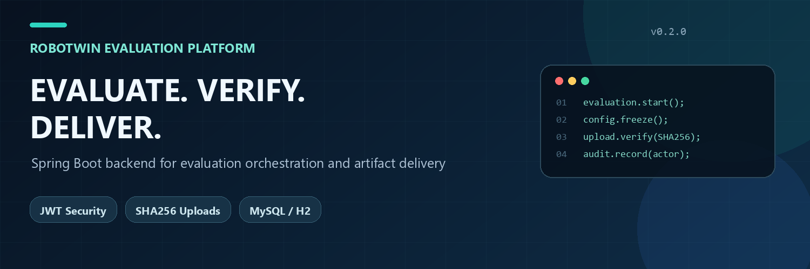
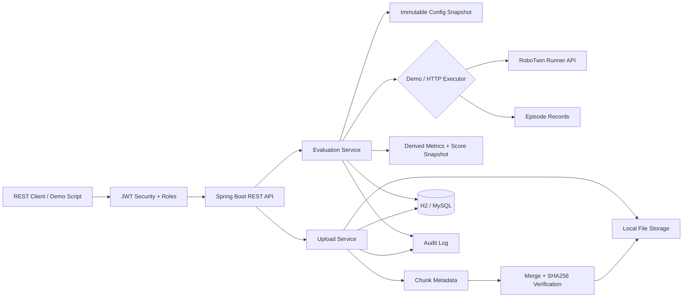

# RoboTwin Evaluation Platform

[](https://github.com/jimi-21/robotwin-evaluation-platform/actions/workflows/ci.yml)
[](https://openjdk.org/projects/jdk/17/)
[](https://spring.io/projects/spring-boot)
[](https://github.com/jimi-21/robotwin-evaluation-platform)

基于真实 RoboTwin 比赛工程经历，使用 **Java 17 / Spring Boot 3** 独立实现的模型评测与交付后端。覆盖评测任务状态机、不可变配置快照、逐场结果审计，以及大文件分片上传、断点续传和 SHA256 完整性校验。

> 本项目是后续 Java 工程化实现，不是原比赛代码、官方评测平台或官方上传服务端。默认 `demo` 执行器生成明确标记的合成数据；`examples/score_audit.json` 是本地历史评测样本，不代表官方分数或排名。

## 核心能力

- **模型版本登记**：记录基座、产物 URI 与 SHA256，防止同名版本重复登记。
- **评测状态机**：`PENDING → RUNNING → SUCCEEDED / FAILED`，支持失败后的有限次数重试。
- **不可变配置**：创建时冻结场景、推理种子、步数上限和扩展参数，后续执行不读取可变共享配置。
- **可替换执行器**：默认 `demo` 演示任务编排；切换到 `http` 后，通过健康检查和逐场 Runner API 连接真实 RoboTwin 运行环境。
- **真实结果导入**：校验导入场景与计划完全一致，保存原始计分快照，并从 episode 重新计算汇总指标。
- **可靠文件交付**：乱序分片、分片哈希、重复分片幂等、冲突检测、断点查询、流式合并和整文件 SHA256 校验。
- **跨实例互斥**：通过数据库 `PESSIMISTIC_WRITE` 行锁串行化同一上传会话的写入与合并，不再依赖 JVM 内锁。
- **失败可恢复**：合并或整文件哈希失败时保留分片，只有校验成功才进入 `COMPLETED` 并开放下载。
- **JWT 与角色权限**：BCrypt 密码校验、HS256 Bearer Token，管理员可读写，只读用户仅可查询。
- **可追踪审计**：关键状态变更写入审计表并记录实际操作人，请求通过 `X-Request-Id` 关联。
- **工程基础**：Flyway 迁移、Bean Validation、RFC 7807 错误响应、Swagger UI、健康检查和集成测试。

## 架构



## 快速启动

要求：JDK 17、Maven 3.9+。默认使用文件型 H2，不需要安装数据库或 Docker。

```bash
mvn clean verify
mvn spring-boot:run
```

打开：

- Swagger UI：<http://localhost:8080/swagger-ui.html>
- 健康检查：<http://localhost:8080/actuator/health>

本机默认账号为 `admin / robotwin-local-admin`，只读账号为 `viewer / robotwin-local-viewer`。调用 `POST /api/v1/auth/login` 获取 Token；在 Swagger 中点击 `Authorize` 并填入 `accessToken`，不需要手写 `Bearer` 前缀。公开部署前必须通过环境变量更换默认密码和 JWT 密钥。

另开一个终端，在项目根目录运行真实 HTTP 演示：

```bash
python scripts/demo.py
```

脚本只使用 Python 标准库，会完成：

1. 登录获取 JWT，后续请求自动携带 Bearer Token；
2. 注册模型并创建五场景评测，启动异步执行并读取 episode 与审计记录；
3. 导入本地历史 `score_audit.json`，核对 `79.7`、`3/5` 等结果；
4. 以三个分片乱序上传文件，重复发送一个分片验证幂等；
5. 合并、校验、下载并重新计算 SHA256。

## API 摘要

| 方法 | 路径 | 用途 |
|---|---|---|
| `POST` | `/api/v1/auth/login` | 登录并获取 JWT，其他业务接口需要 Bearer Token |
| `POST` | `/api/v1/models` | 登记模型版本 |
| `GET` | `/api/v1/models` | 查询模型版本 |
| `POST` | `/api/v1/evaluations` | 创建评测并冻结配置 |
| `POST` | `/api/v1/evaluations/{id}/start` | 启动或重试异步评测 |
| `POST` | `/api/v1/evaluations/{id}/results` | 导入 `score_audit` 结果 |
| `GET` | `/api/v1/evaluations/{id}` | 查询状态与汇总指标 |
| `GET` | `/api/v1/evaluations/{id}/episodes` | 查询逐场结果 |
| `POST` | `/api/v1/uploads` | 初始化上传计划 |
| `PUT` | `/api/v1/uploads/{id}/chunks/{partNumber}` | 上传分片，需 `X-Chunk-SHA256` |
| `GET` | `/api/v1/uploads/{id}` | 获取已确认分片和下一断点 |
| `POST` | `/api/v1/uploads/{id}/complete` | 合并并校验完整文件 |
| `GET` | `/api/v1/uploads/{id}/content` | 下载已完成文件 |
| `GET` | `/api/v1/audit-logs/{entityType}/{entityId}` | 查询实体审计记录 |

### 分片约束

- 分片编号从 `1` 开始；最后一片可以小于声明的 `chunkSize`。
- `chunkSize` 范围为 64 KiB～16 MiB，单文件上限为 1 TiB。
- 相同 `uploadId + partNumber + 内容` 重复提交返回当前进度，不重复计数。
- 同一编号提交不同内容返回 `409 CHUNK_CONFLICT`。
- 分片内容或声明哈希不符时返回 `422`，不会写入元数据。
- 整文件哈希不符时返回 `422 FILE_HASH_MISMATCH`，已确认分片保留。

## 接入真实 RoboTwin Runner

默认 `EVALUATION_EXECUTOR=demo`，仅用于展示状态机。连接实际仿真环境时，将 `EVALUATION_EXECUTOR` 改为 `http`：

```bash
EVALUATION_EXECUTOR=http \
ROBOTWIN_BASE_URL=http://localhost:8000 \
ROBOTWIN_API_KEY=your-runner-key \
mvn spring-boot:run
```

Runner 应包装 RoboTwin 的场景 reset、推理循环、环境 step、成功判定和结果收集；它不是只返回一次模型动作的 `/predict` 接口。Java 服务调用前会请求 `GET /health`，HTTP 2xx 且 JSON 中的 `ready` 不为 `false` 才继续。

随后，Java 服务按配置中的场景顺序调用 `POST /v1/episodes`。请求示例：

```json
{
  "evaluationId": "188aedba-6e56-4ed3-ab51-634eb38e8b6c",
  "episodeIndex": 0,
  "sceneSeed": 2,
  "inferenceSeed": 42,
  "maxSteps": 400,
  "numInferenceSteps": 10,
  "parameters": {}
}
```

Runner 返回一场完整评测结果：

```json
{
  "result": "SUCCESS",
  "steps": 232,
  "jitter": 0.270204,
  "instruction": "Task instruction",
  "videoUri": "local://episode-1.mp4",
  "armTag": "dual",
  "failureReason": null
}
```

`result` 必须为 `SUCCESS`、`FAILURE` 或 `TIMEOUT`，`steps` 必须为正数。HTTP 错误、健康检查失败、响应结构非法都会将本次运行标记为 `FAILED`，不会伪装为成功。设置 `ROBOTWIN_API_KEY` 后，请求会携带 `X-API-Key`。路径和超时可通过下方环境变量调整。

## MySQL / Docker

开发环境可用 Docker Compose 启动 MySQL 8.4 和应用：

```bash
docker compose up --build
```

也可以自行启动 MySQL，再运行：

```bash
mvn spring-boot:run -Dspring-boot.run.profiles=mysql
```

主要环境变量：

| 变量 | 默认值 | 说明 |
|---|---|---|
| `DB_URL` | 文件型 H2 | JDBC 地址 |
| `DB_USERNAME` | `sa` | 数据库用户 |
| `DB_PASSWORD` | 空 | 数据库密码 |
| `STORAGE_ROOT` | `./storage` | 分片及完成文件目录，多实例必须指向共享存储 |
| `APP_JWT_SECRET` | 本机开发值 | HS256 密钥，至少 32 个 UTF-8 字节，部署时必须更换 |
| `ACCESS_TOKEN_TTL` | `2h` | 登录 Token 有效期 |
| `ADMIN_USERNAME` / `ADMIN_PASSWORD` | 本机开发账号 | 管理员账号 |
| `VIEWER_USERNAME` / `VIEWER_PASSWORD` | 本机开发账号 | 只读账号 |
| `EVALUATION_EXECUTOR` | `demo` | `demo` 或 `http` |
| `EVALUATION_DEMO_DELAY` | `50ms` | 每个演示 episode 的延迟 |
| `ROBOTWIN_BASE_URL` | `http://localhost:8000` | Runner 服务地址 |
| `ROBOTWIN_HEALTH_PATH` | `/health` | Runner 健康检查路径 |
| `ROBOTWIN_EPISODE_PATH` | `/v1/episodes` | Runner 单场评测路径 |
| `ROBOTWIN_API_KEY` | 空 | 可选 Runner API Key |
| `ROBOTWIN_CONNECT_TIMEOUT` | `5s` | Runner 连接超时 |
| `ROBOTWIN_REQUEST_TIMEOUT` | `10m` | 单场请求超时 |
| `SERVER_PORT` | `8080` | HTTP 端口 |

Compose 中的密码仅用于本机演示，部署时应改为外部密钥配置。

## 测试

```bash
mvn clean verify
```

集成测试通过 MockMvc 和真实 H2/Flyway 覆盖：

- 异步评测、配置快照、逐场结果和审计事件；
- 基于真实 HTTP 服务模拟的 Runner 契约、请求参数、API Key 和未就绪失败路径；
- JWT 登录、匿名拒绝、角色权限、错误密码和非法 Token；
- 真实样本导入、指标计算、场景不匹配与重复场景拒绝；
- 乱序上传、断点恢复、重复分片、冲突分片与完整下载；
- 8 路并发重复分片的数据库行锁与幂等验证；
- 缺失分片、分片哈希错误、整文件哈希错误和文件名路径穿越。

GitHub Actions 位于 `.github/workflows/ci.yml`，推送后会使用 JDK 17 执行 `mvn -B verify`。

## 代码结构

```text
src/main/java/dev/robotwin/evalhub
├── audit/        审计记录与查询
├── auth/         登录、JWT 签发与角色响应
├── common/       统一异常、ProblemDetail、Request ID
├── config/       安全、执行器、存储与 API 文档配置
├── evaluation/   状态机、Demo/HTTP 执行器、结果导入与指标
├── model/        模型版本
└── upload/       分片协议、本地存储、合并校验与下载
```

## 当前边界与下一步

这是可运行的单体后端参考实现，不宣称生产就绪：

- HTTP 执行器及失败路径已经过契约测试，但本仓库不包含 RoboTwin 上游框架、模型权重或仿真数据；仍需在实际 Runner 上联调。
- 上传互斥已改为数据库行锁，可跨应用实例工作；多机器部署仍须提供一致的共享文件系统，或把本地存储替换为 MinIO/OSS。
- 已提供 JWT 和角色权限，但账号目前是启动时配置的内存用户；正式系统应接入持久化用户或统一身份平台，并增加 Token 撤销、上传配额和 HTTPS。
- 暂未接入消息队列、对象存储和 Prometheus；应在确有部署需求时增加，而不是只堆技术名词。

## 简历表述

> 基于本人 RoboTwin 比赛中的评测与交付流程，独立设计并实现 Spring Boot 后端。通过不可变配置快照、异步任务状态机和逐场事务落库实现评测追踪，提供可切换的 RoboTwin HTTP 执行器；设计分片上传协议，支持断点续传、分片幂等、数据库行锁和 SHA256 合并校验；加入 JWT 角色权限、Flyway、MySQL/H2、Swagger 和集成测试。
